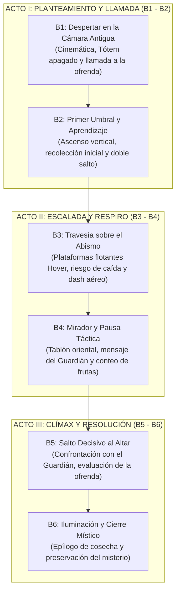
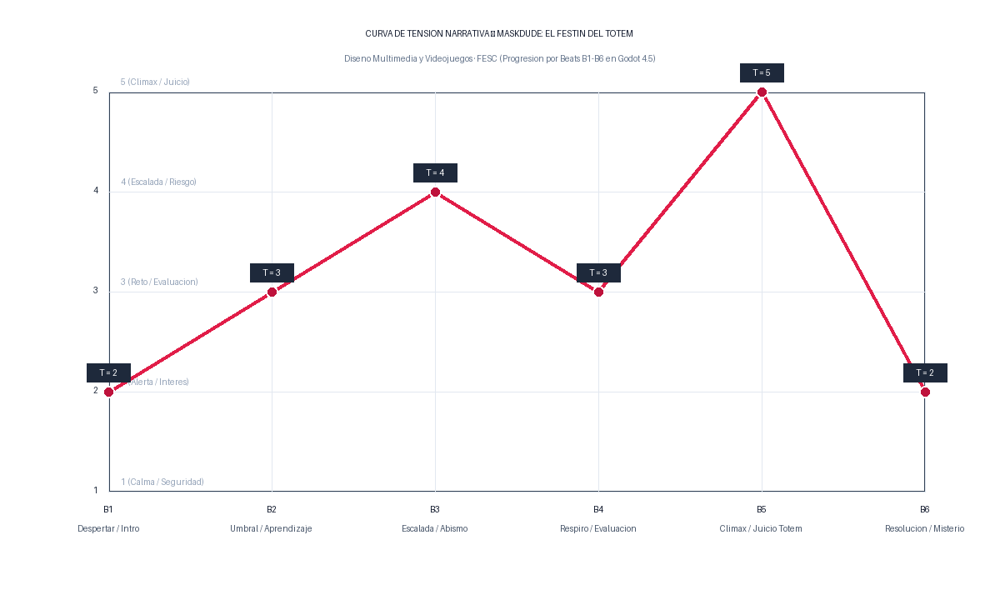

# Entregable 2: Estructura Narrativa y Curva de Tensión — MaskDude

> **Asignatura:** Diseño Multimedia y Videojuegos · 9.º Semestre  
> **Institución:** Fundación de Estudios Superiores Comfanorte (FESC)  
> **Proyecto:** MaskDude — *El Festín del Tótem*  
> **Nivel Analizado:** Level 1 (*La Cámara Antigua*)  
> **Estado del Entregable:** Completo y Verificado

---

## 1. Estructura Dramática en Tres Actos para Nivel Único

El primer nivel de MaskDude condensa una progresión dramática completa dentro de una cámara de 32x18 tiles (512x288 px), asegurando que cada incremento de tensión narrativa esté acompañado por una demanda motriz verificable en el motor Godot 4.5.

---

## 2. Desglose Detallado de Beats Narrativos

Un **beat** representa un acontecimiento o cambio significativo en el estado del juego que altera la relación entre el jugador, sus metas y el entorno.

### Escala Cualitativa de Tensión (1 a 5):
- **1 — Calma / Seguridad:** Ausencia de amenaza inmediata; contemplación o asimilación de información.
- **2 — Alerta / Interés:** Planteamiento de la meta, revelación del contexto y exploración segura.
- **3 — Reto Moderado / Evaluación:** Demanda de coordinación de mecánicas sin penalización crítica.
- **4 — Riesgo Crítico / Escalada:** Alta exigencia motriz; margen de error reducido con peligro inminente de caída al abismo.
- **5 — Clímax / Máxima Expectativa:** Momento decisivo de mayor compromiso narrativo; juicio y resolución del conflicto.

---

### Tabla Maestra de Beats Narrativos

| Beat / Acto | Acontecimiento y Acción del Jugador | Tensión (1-5) y Justificación Narrativa | Dificultad (1-5) y Justificación Motriz | Señal Sensorial y Condición de Avance |
| :---: | :--- | :--- | :--- | :--- |
| **B1** Acto I: Planteamiento | **Acontecimiento:** Tarjetas de contexto sobre fondo negro. Se revela el nivel; el Tótem emite un tenue destello y solicita la ofrenda. **Acción:** Lectura del diálogo inicial (`Enter` o `E`). El jugador permanece bloqueado (`State.LOCKED`). | **Tensión: 2 / 5** *Justificación:* Curiosidad e intriga por el apagón del Guardián y la urgencia antes del amanecer. | **Dificultad: 1 / 5** *Justificación:* Nula exigencia física; interacción pasiva con la interfaz. | **Señal:** SFX `mushroomappear.ogg` al encenderse el Tótem; cuadro de diálogo retro. **Avance:** Fin del diálogo; se desbloquea el control (`set_locked(false)`). |
| **B2** Acto I: Umbral | **Acontecimiento:** Entrada a la zona de saltos verticales sobre bloques piramidales (`Pyramid3`, `Pyramid4`). **Acción:** Desplazamiento horizontal y ejecución del primer salto vertical y doble salto (`Espacio`/`W`). Recolección de las primeras frutas (`Bananas1`, `Apple8`). | **Tensión: 3 / 5** *Justificación:* Comprensión práctica de la dispersión de las frutas y la necesidad de impulsos elevados. | **Dificultad: 2 / 5** *Justificación:* Suelo firme bajo el jugador; no existe peligro de caída al vacío. | **Señal:** Notificación flotante `hint_double_jump`; sonido de recolección `coin.ogg`. **Avance:** Alcanzar el borde del bloque inicial (coordenada $X > 140$). |
| **B3** Acto II: Escalada | **Acontecimiento:** El suelo firme desaparece; se abre un abismo cavernoso superable únicamente mediante plataformas suspendidas (`Hover1` a `Hover4`). **Acción:** Saltos de precisión encadenando doble salto y dash horizontal (`Shift`/`K`) en el aire para recoger frutas suspendidas en el vacío (`Melon4`, `Kiwi3`, etc.). | **Tensión: 4 / 5** *Justificación:* La caída al vacío implica perder el progreso de posición y reaparecer al inicio. | **Dificultad: 4 / 5** *Justificación:* Exigencia de timing estricto en la inercia aérea y administración de la carga única de dash. | **Señal:** SFX de dash `fireball.ogg`, estela de imágenes fantasma (`_spawn_ghost()`) y aviso emergente `hint_dash`. **Avance:** Aterrizar con éxito en la plataforma flotante `Hover4`. |
| **B4** Acto II: Respiro | **Acontecimiento:** Aterrizaje en el saliente derecho (`Pyramid5`, $X = 402$). El Guardián percibe la cercanía del elegido. **Acción:** Pausa motriz voluntaria; lectura del diálogo intermedio (`totem_midway`). El jugador verifica su contador en el HUD (`Frutas: N/13`). | **Tensión: 3 / 5** *Justificación:* Alivio por dejar atrás el abismo; evaluación tensa de cuántas frutas faltan antes del salto final. | **Dificultad: 1 / 5** *Justificación:* Plataforma ancha y segura; no hay enemigos ni desmoronamiento. | **Señal:** Diálogo emergente con el Tótem Dorado: *«Ya siento tu ofrenda, guardián...»* **Avance:** El jugador avanza hacia el último tramo vertical. |
| **B5** Acto III: Clímax | **Acontecimiento:** Llegada al altar superior donde descansa el Guardián de la Cosecha (`Goal`). Juicio de la ofrenda. **Acción:** Salto final y contacto físico con el área del Tótem. El control se bloquea para el desenlace. | **Tensión: 5 / 5** *Justificación:* Máximo compromiso dramático: se sella el destino de la cosecha y se enfrenta la tradición de los antecesores. | **Dificultad: 3 / 5** *Justificación:* Salto de aproximación final sin margen de fallo severo. | **Señal:** Detención de la música `overworld.ogg`; jingle triunfal `Win` y resonancia `Totem`. Interpolación visual del resplandor dorado. **Avance:** Señal `level_completed` emitida por el nodo `Goal`. |
| **B6** Acto III: Resolución | **Acontecimiento:** Diálogo final y pantalla de epílogo (`_show_end_card()`). El Guardián reacciona proporcionalmente a las frutas entregadas. **Acción:** Lectura del epílogo final y contemplación del misterio de la máscara. Opción de reinicio (`R`). | **Tensión: 2 / 5** *Justificación:* Catarsis y distensión tras cumplir la misión; resonancia del misterio no resuelto de los antiguos guardianes. | **Dificultad: 1 / 5** *Justificación:* Finalización de la partida. | **Señal:** Fade a negro; texto de epílogo en letras doradas y contador final. **Avance:** Cierre de la experiencia jugable. |

---

## 3. Curva Gráfica de Tensión vs. Progresión

La siguiente gráfica representa la evolución temporal y dramática a lo largo de los seis beats documentados:

### Correspondencia de Ejes y Valores:
- **Eje X (Beats):** B1 (Planteamiento, $T=2$) $\rightarrow$ B2 (Umbral, $T=3$) $\rightarrow$ B3 (Escalada, $T=4$) $\rightarrow$ B4 (Respiro, $T=3$) $\rightarrow$ B5 (Clímax, $T=5$) $\rightarrow$ B6 (Resolución, $T=2$).
- **Eje Y (Tensión):** Escala cualitativa de 1 a 5 con descriptores narrativos.

---

## 4. Análisis de Ritmo, Respiro y Sistema de Reintento

### 4.1. Tensión Dramática vs. Dificultad Mecánica
En MaskDude, la dificultad y la tensión no son equivalentes:
- En **B1**, la tensión es moderada ($T=2$) por la revelación de la crisis, pero la dificultad motriz es nula ($D=1$).
- En **B3**, la dificultad motriz ($D=4$) empuja la tensión narrativa ($T=4$) al combinar el miedo visceral a la caída con la urgencia del amanecer.
- En **B4**, se introduce un **valle deliberado de dificultad** ($D=1$) que reduce la tensión a $T=3$, permitiendo al jugador procesar la información del contador antes de comprometerse con el clímax.

### 4.2. El Momento de Respiro Táctico (Beat B4)
Ubicado en el saliente oriental previo a la meta, el trigger `Trigger_totem_midway` actúa como una válvula de descompresión psicológica. El diseño de niveles otorga un espacio amplio donde la cámara se estabiliza (`position_smoothing = 8.0`), permitiendo al usuario contemplar las frutas que haya dejado atrás y decidir si se arriesga a retroceder o avanza a concluir la misión.

### 4.3. Sistema de Reintento y Recuperación (Retry Loop)
- **Detección de Caída:** El script [`Level1.gd`](file:///C:/Users/ALEJANDRO/OneDrive/Documentos/MaskDude/scripts/levels/Level1.gd#L36-L41) evalúa continuamente la posición en el eje Y. Si $Y > \text{límite} + 48\text{ px}$, se emite la señal `player_fell` y se reproduce `death.ogg`.
- **Preservación del Ritmo:** El jugador reaparece inmediatamente mediante `player.respawn_at(_respawn_position)`.
- **Sin Frustración Arbitraria:** El reintento **NO reinicia la cinemática de introducción ni reaparece los diálogos ya leídos**. Las frutas previamente recolectadas se mantienen en el inventario, protegiendo el esfuerzo del jugador y manteniendo el ritmo de la experiencia.
